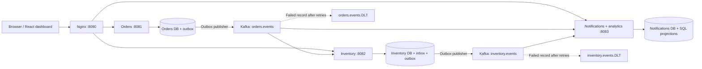

# Order Pulse — event-driven order platform

Three Spring Boot services coordinate order creation, inventory reservations and durable notifications through Kafka. A React dashboard shows orders per minute, available stock and order outcomes, refreshed every two seconds from SQL projections.

## Run locally

Prerequisites: Docker Desktop/Engine with Compose v2, roughly 6–8 GiB available Docker memory, and internet access for the first build.

```sh
docker compose up -d --build
```

Open **http://localhost:8090**. Create an order in the dashboard; its reservation appears automatically. The first build can take several minutes. Kafka and PostgreSQL must pass health checks before services start. The dashboard retries while services initialize.

```sh
# Verify the complete pipeline (Python 3, standard library only).
python3 scripts/smoke.py
# View service logs.
docker compose logs -f orders inventory notifications
# Stop containers, preserving data.
docker compose down
```

Initial stock: 10,000 laptops, 25,000 headphones, 15,000 keyboards. SQL initialization seeds only new databases; restarting preserves current stock. PostgreSQL and Kafka use named volumes. The only published port is dashboard/API port 8090. Set `HTTP_PORT` to change it. Set `DATABASE_PASSWORD` in an uncommitted `.env` file for a non-default password.

## Architecture



One PostgreSQL server hosts three separate databases. Each service owns its own business tables, inbox and outbox; no service queries another service's database. Notifications also owns the analytics consumer to keep the application at exactly three Spring Boot services. The stock endpoint reads authoritative inventory; event-driven stock snapshots also live in the analytics database.

| Component | Responsibility |
|---|---|
| Orders | Validated REST creation; HTTP idempotency; orders and event outbox saved atomically |
| Inventory | Consume `OrderCreated`; lock stock row; reserve or reject; save inbox, reservation and completion outbox atomically |
| Notifications | Consume order/completion events; deduplicate; aggregate minute buckets and final statuses; save one durable notification record per order |
| React + Nginx | Same-origin API routing, live polling, chart, stock, recent orders and order creation |

## Event delivery and failure behavior

Events have `eventId`, `type`, `orderId`, `sku`, `quantity`, optional `stock` and UTC `occurredAt`. Types are `OrderCreated`, `StockReserved`, `StockRejected`. Three partitions per topic; the SKU key keeps stock updates for a product on one partition.

- Transactional outbox: business writes and the outgoing event commit together in PostgreSQL. A scheduled publisher sends pending records with `acks=all` and Kafka producer idempotence, then marks them published. Kafka failures leave records pending. A crash after send and before SQL commit can resend a record.
- Idempotent consumers: `(consumer,event_id)` has a unique constraint. The inbox marker and all SQL side effects commit in the same transaction; exceptions roll everything back. Kafka commits record offsets only after successful handling. Reservations and notifications also have unique order IDs. Repeated HTTP requests with the same `Idempotency-Key` return the same order; a different payload with that key returns 409.
- Dead letters: unhandled failures receive up to three retries at 500 ms intervals, then move to `<source>.DLT` with Spring Kafka diagnostic headers. A failed DLT publish throws so the source offset is not treated as successfully recovered. Insufficient stock is a normal `StockRejected` outcome; malformed envelopes or unknown SKUs are failures.
- Cross-topic ordering: completion can precede `OrderCreated`. The analytics upsert preserves final status and fills in creation time later. One order contributes exactly once to a minute bucket, even if repeated under a new event ID. Stock snapshots only decrease in this reservation-only model, so replaying an older snapshot cannot increase projected stock.

These are at-least-once delivery semantics with idempotent SQL effects. This is not a claim of globally exactly-once Kafka/SQL delivery. This demo uses one outbox publisher instance per service and a single broker. Restocking, distributed publisher ordering, retention/archival, authentication, high availability and external email delivery are future production work.

Inspect failed messages locally:

```sh
docker compose exec kafka /opt/kafka/bin/kafka-console-consumer.sh \
  --bootstrap-server kafka:9092 --topic orders.events.DLT --from-beginning \
  --property print.headers=true --max-messages 1
```

Fix the underlying cause before replaying a DLT payload to its original topic, preserving event ID and SKU key. Existing successful consumers ignore duplicates; the failed consumer's transaction did not commit its inbox marker. Do not blindly replay an event with an invalid schema.

## API

```sh
curl -i http://localhost:8090/api/orders \
  -H 'Content-Type: application/json' \
  -H 'Idempotency-Key: example-001' \
  -d '{"sku":"HEADPHONES","quantity":2}'
curl http://localhost:8090/api/stock
curl http://localhost:8090/api/metrics
```

`GET /api/orders/{id}` returns the accepted order record. Completion status is in `/api/metrics`'s recent-order projection. Requests require one of the three catalog SKUs, quantity 1–1,000, and a nonblank idempotency key of at most 128 characters. Dashboard timestamps display the browser timezone; minute aggregation uses UTC event time.

## Tests and CI

```sh
# Java 17+, Maven 3.9+, running Docker required.
mvn -B verify
# Node 22 recommended.
cd dashboard
npm ci
npm run build
```

JUnit tests run against real Kafka and PostgreSQL via Testcontainers. They cover HTTP idempotency, conflicting retries, input validation, Kafka redelivery, insufficient stock, rollback plus DLT delivery, cross-topic reordering, duplicate aggregation and older snapshot replay. Containers are required; integration tests do not silently skip without Docker.

GitHub Actions runs Java/JUnit/Testcontainers, builds the React bundle, and starts the Compose stack for an HTTP end-to-end test on every push and pull request. Push this project to GitHub to activate the workflow; local files alone do not create a remote repository or trigger CI.

## Measured result

**Measured locally: 1,000 unique orders completed in 5.61 seconds (178.24 completed orders/sec), with zero duplicate order effects across 2,000 HTTP requests.** Hardware, test scope and raw output are recorded in [docs/RESULTS.md](docs/RESULTS.md). Reproduce on an otherwise idle stack with sufficient headphone stock:

```sh
python3 scripts/benchmark.py --orders 1000 --workers 20
```

The script submits 1,000 unique orders and repeats every HTTP request with its original idempotency key. It waits for SQL analytics to report all final reservations, verifies exactly 1,000 stock deductions and zero duplicate order effects, and writes `reports/benchmark.json`. Reported throughput includes HTTP ingress, both outbox publishers, Kafka consumers, and final SQL aggregation; it is **completed orders/sec**, not raw Kafka events/sec. It changes inventory and preserves created orders.

## AWS live demo

Deployment files and instructions: [docs/AWS.md](docs/AWS.md), [infra/main.tf](infra/main.tf).

**Live AWS URL: pending deployment.** An AWS account, a published Git repository and a reviewed infrastructure plan are needed. EC2 hosting can incur charges; account credits may cover eligible usage. No fabricated public demo URL or throughput claim is included.

The Terraform plan creates one EC2 host, an HTTP security group scoped to the supplied viewer CIDR, and a Session Manager role. User data installs Docker and launches the same Compose stack. It leaves Kafka/PostgreSQL internal, persists data across container restarts, and emits the actual demo URL. See the deployment guide for teardown and limitations.
