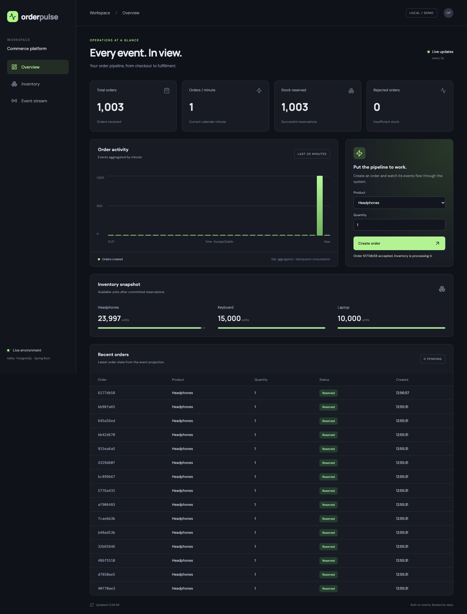

# Local validation and measured result

Measured on 5 October 2026 on macOS 14.6 / ARM64, using Docker Desktop with 8 CPUs and approximately 7.65 GiB memory assigned. This is a single local run on a developer machine, not a sustained capacity limit or AWS benchmark.

**1,000 unique orders completed in 5.61 seconds (178.24 completed orders/sec), with zero duplicate order effects.**

| Measurement | Result |
|---|---:|
| Unique orders | 1,000 |
| HTTP POST requests | 2,000 |
| Concurrent client workers | 20 |
| HTTP submission duration | 2.563 s |
| End-to-end completion duration | 5.61 s |
| Completed orders/sec | 178.24 |
| Stock deductions | 1,000 |
| Duplicate order effects | 0 |

Each HTTP request was retried using the original idempotency key. The script verified unique returned order IDs, the total SQL analytics count, final reservation count, unchanged rejection count, and exactly one stock deduction per unique order. Duration includes order acceptance, both outbox publishers, Kafka, inventory reservation, and analytics SQL projection. Completion is sampled once per second; throughput is approximate. It does not measure raw Kafka events/sec, prolonged load, or crash recovery during this run.

Raw output: [benchmark.json](benchmark.json). Reproduce against an otherwise idle stack:

```sh
python3 scripts/benchmark.py --orders 1000 --workers 20
```

## Completed checks

- `mvn -B verify`: **9 tests passed, 0 failed, 0 errors, 0 skipped**. Kafka and PostgreSQL are real Testcontainers instances. Tests include duplicate Kafka delivery, SQL rollback on invalid SKU and DLT delivery, insufficient stock, HTTP retry conflicts, cross-topic reordering, duplicate aggregation and stale stock replay.
- React production build: successful; 35 modules transformed, approximately 200 kB JavaScript / 62.8 kB gzip.
- Docker Compose: all six containers running; Kafka and PostgreSQL healthy.
- HTTP smoke test: passed; repeated order request produced one order, one stock deduction and one SQL aggregate with final reservation state.
- Headless Chrome: desktop and mobile rendering, order creation and final reservation update passed; no page JavaScript errors or mobile viewport overflow.

## Dashboard



- Terraform 1.13.3 with AWS provider 5.100.0: `init -backend=false` and `validate` passed. No AWS resources were created.

AWS deployment and GitHub-hosted Actions execution require account/repository access and have not been performed.
